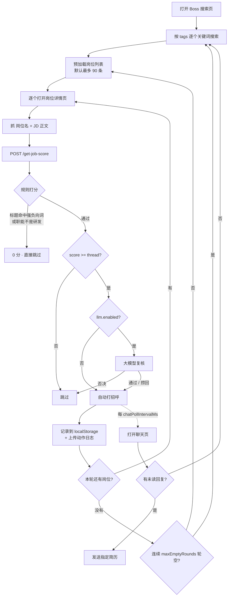

# EzJob

**面向 Boss 直聘的自动投递脚本：浏览器端干活，本地 Python 端做判断。**

浏览器脚本负责一切页面操作（搜索、翻页、开详情、打招呼、发简历），本地后端只做一件事——
**判断这个岗位值不值得投**。判断链路是「规则先筛 → 大模型复核」，规则负责一眼就不对
的岗位，模型负责规则拿不准的岗位。

[](#环境要求)
[](#3-安装浏览器脚本)
[](#5-启动后端)
[](#llm-可选的大模型复核)
[](LICENSE)

---

## 它做什么

一句话：**打开 Boss 搜索页，勾上你设的关键词，剩下的交给它。**

- 按 `tags` 轮换搜索，自动翻页、自动打开岗位详情
- 抓岗位名 + JD 正文，送到本地后端打分
- 分数过阈值 → 自动打招呼，填入你写好的固定招呼语
- HR 回复后 → 自动发送你**指定的那一份**简历（不是平台模板）
- 一轮搜完没新岗位 → 换下一个关键词继续，默认一直挂着
- 触到日限额 / 平台风控提示 → 立刻暂停，不硬冲

## 它不做什么

明确一下边界，省得期待错位：

- ❌ 不是多平台框架，只支持 Boss 直聘
- ❌ 不做多轮 AI 代聊（`/reply` 那套是遗留能力，默认不走）
- ❌ 不保证投递被回复，它只负责把简历递出去
- ❌ 不会绕过平台限制，日限额就是硬上限

## 适合什么岗位方向

仓库内置的词表和默认配置，是**两条线并行**调的：**Agent / AI 应用开发** + **Java 后端 / 全栈开发**。

| 会投 | 不投（命中直接 0 分） |
|---|---|
| AI Agent 开发、智能体开发 | 算法 / 模型训练 / 微调 / 推理优化 |
| AI 应用开发、大模型应用开发 | 产品经理、项目经理、产品运营 |
| RAG / LangGraph / MCP / 工作流 | 市场、销售、售前、解决方案、交付 |
| AI Engineer / GenAI Engineer / FDE | 测试、运维、SRE、DevOps、外包驻场 |
| Java 后端、Java 全栈、服务端开发 | C++ / Go / Rust / PHP 技术栈 |
| 全栈开发（Java + 前端） | 纯前端 / Node / JavaScript / TypeScript 全栈 |

两条线的分数是独立算的：Agent 岗靠 JD 里的 Agent/RAG 词拿分，Java 岗靠 Spring/MySQL/Redis 这一桶拿分，
互不干扰。要只投其中一条，把另一条的词表清空就行。

词表全部可改，见 [`scoring`](#scoring-打分规则)。

---

## 工作流



---

## 快速开始

### 环境要求

- **Python 3.10+**（代码用了 `dict | None` 这类写法，3.9 跑不起来）
- **Tampermonkey**（Chrome / Edge 均可）
- 一个已登录的 Boss 直聘账号

### 1. 拉代码、装依赖

```bash
git clone https://github.com/LIUlin11037/EZ4Job.git
cd EZ4Job
pip install -r requirements.txt
```

> `requirements.txt` 里的 `ollama` 只服务遗留接口（`/reply`、`/is-need-resume`、`/is-need-works`）。
> 主链路不需要它，也没装 Ollama 也能跑。嫌重可以手动跳过它。

### 2. 生成配置

```bash
cp user_config.example.json user_config.json
```

然后改这四项就能跑了：

| 字段 | 说明 |
|---|---|
| `tags` | 搜索关键词列表，例如 `["AI Agent", "智能体开发"]` |
| `introduce` | 打招呼的固定话术，**控制在 160 字内** |
| `frontend.thread` | 投递阈值，`score >= thread` 才打招呼（默认 90） |
| `frontend.resume.profiles` | 要发的那份简历的文件名关键字（单份用 `resume.match`） |

### 3. 安装浏览器脚本

1. 打开 Tampermonkey → 添加新脚本
2. 把 `web_script.js` **整个文件**粘进去
3. `Ctrl+S` 保存

### 4. 启动后端

```bash
python main.py
```

Windows 双击 `start_backend.bat` 也行。看到 `Uvicorn running on http://0.0.0.0:8000` 就成功了。

自检一下：

```bash
curl http://127.0.0.1:8000/client-config
```

能返回你的 `tags` / `introduce` / `frontend` 就说明前后端通了。

### 5. 开跑

打开 `https://www.zhipin.com/web/geek/job?query=AI%20Agent`，右下角会出现控制面板，点「开始」。

---

## 目录结构

```text
EzJob/
├── main.py                    # FastAPI 入口：打分、日志、统计
├── core.py                    # 规则打分主逻辑（岗位匹配的核心）
├── llm_judge.py               # 大模型判岗：调用、缓存、结论合并
├── config.py                  # 默认配置 + 加载/校验（含全部词表）
├── web_script.js              # Tampermonkey 脚本：所有页面操作
├── prompts.py                 # 遗留 ollama 接口的提示词
├── schema.py                  # 遗留接口的 Pydantic 模型
├── tools.py                   # 小工具：LLM 输出清洗、分数提取
├── cache.py                   # 遗留只读兼容层，主链不依赖
├── test_single_route_backend.py  # 打分链路自测
├── user_config.example.json   # 配置模板（公开）
├── resume-example.md          # 简历模板（公开）
├── DEV_LOG.md                 # 开发演进记录，含每个 bug 的根因
├── requirements.txt
└── readme.md
```

**运行时才会生成、且不进仓库的文件：**

| 文件 | 内容 |
|---|---|
| `user_config.json` | 你的真实配置，**含 API Key 和个人画像** |
| `job_decisions.jsonl` | 每个岗位的打分明细（含 LLM 结论） |
| `job_actions.jsonl` | 前端动作日志：打招呼、发简历、失败原因 |
| `resume.md` | 你的真实简历 |

> ⚠️ 这四个都在 `.gitignore` 里。**不要**手动 `git add -f` 它们。

---

## 配置详解

所有用户差异化内容都集中在 `user_config.json`。`config.py` 里的默认值只是兜底。

> **注意：**`web_script.js` 顶部的 `OPTIONS` 也是一层兜底默认值。
> 脚本启动时会先请求 `/client-config`，用后端返回的值覆盖它。
> **改参数请改 `user_config.json`，改 `web_script.js` 里的 OPTIONS 没用。**

### 顶层字段

| 字段 | 说明 |
|---|---|
| `tags` | 搜索关键词列表。**建议 4~5 个**，太多会让单轮搜得太久 |
| `introduce` | 固定招呼语 |
| `character` | 遗留代聊用的语气设定 |
| `resume_name` / `think_model` / `chat_model` | 遗留字段，主链不用 |

### 招呼语怎么写

`introduce` 是唯一会被 HR 直接读到的东西，值得单独调。

- **160 字以内**。手机端首屏约 3 行，超过就不读了；超过 180 字脚本会在面板里标红提示
- 顺序：`身份 + 方向` → `一个项目钩子（技术点 ≤ 4 个）` → `一个数字` → `明确动作`
- 只留一个最亮的量化结果。token 降幅、成本、准确率全堆上去反而像念简历
- 结尾必须是一个动作（"方便发您简历吗"），别用逗号断在半句

参考示例：

```text
您好！我是 XX 本科在读，主攻 Python + Agent。用 LangGraph 独立做过「Agent + RAG」
调研系统：四角色编排、MCP 工具按需装载、检索侧混合召回 + 重排，引用能核到页码，
自建评测集单题成本 ¥0.26，Java 后端也能写。找 AI 应用 / Agent 开发实习，
方便发您简历吗？
```

### `frontend`：投递节奏

| 字段 | 默认 | 说明 |
|---|---|---|
| `thread` | 90 | 投递阈值，低于这个分不打招呼 |
| `onlyGreet` | true | 只打招呼，不做自动代聊 |
| `manualFilterWaitMs` | 15000 | 每轮搜索后留给你手动勾筛选条件的时间 |
| `roundRestartDelayMs` | 4000 | 轮次之间的缓冲 |
| `maxEmptyRounds` | 3 | 连续几轮没新岗位后**切换关键词**（是切换，不是停止） |

### `frontend`：停止条件

全部安全阀都在这里，`0` 表示不限制。

| 字段 | 默认 | 说明 |
|---|---|---|
| `maxGreetsPerDay` | 130 | **当天累计**上限。Boss 硬上限约 150/天，留 20 余量 |
| `maxGreetsPerRun` | 0 | 本次运行上限（日常靠日限兜底就够了） |
| `maxRunHours` | 6 | 本次最多跑几小时 |
| `maxRounds` | 0 | 最多跑几轮 |

达到任一上限后程序进入**暂停**状态（不关页面），面板会显示原因，点「继续」可恢复。

**关于日限，有几件事要知道：**

- 计数同时存在两处：`localStorage.__zhipin_daily_greet`（跨重启有效、跨天归零）
  和后端 `GET /greet-stats`（按 `job_actions.jsonl` 统计当天 `chat_open_requested`），
  启动时取两者**较大值**校准
- 你手动打的招呼脚本统计不到，所以必须留余量，别把 130 改成 150
- 点「继续」只重置本次运行计数，**不会**重置当日计数
- 页面返回"上限 / 次数 / 限制 / 频繁 / 已达"类提示时，脚本**立刻暂停**，不继续消耗额度
- **"温馨提示：还剩 N 次"不算拒绝**。Boss 在沟通数接近上限时会返回
  `温馨提示 / 您今天已与120位BOSS沟通，还剩30次沟通机会哦`——这是要你确认一次，不是封禁。
  脚本的处理是：1.5 秒后自动重试一次；仍被拦就**暂停并提示你手动点一次「继续沟通」**，
  不会把它算进连续失败次数（早先误判成失败，5 次就会把程序停掉，白白浪费剩下的额度）
- 这句提示里的「已与 N 位沟通」会被用来**校正本地日计数**——它算得上你手动打的招呼，
  本地计数算不到，所以以 Boss 的数字为准
- 连续 5 次被平台拒绝也会暂停

除此之外程序默认**无限挂机**：轮次结束只会换关键词，不会自己停。

### `frontend`：超时参数（改之前请先读这段）

| 字段 | 默认 | 说明 |
|---|---|---|
| `detailTimeout` | 15000 | 单个岗位详情的等待上限 |
| `detailRetry` | 1 | 详情**超时**后重试几次（明确失败不重试） |
| `detailReadyTimeout` | 6000 | 详情页等关键 DOM 渲染的上限 |
| `detailOpenWaitMs` | 400 | 打开详情标签后先等多久再开始收消息 |
| `timestampTimeout` | 45000 | 跨标签页回传的时间窗 |
| `greetTimeout` | 25000 | 打招呼回执超时 |

**有一条硬约束：**

```text
timestampTimeout  >  detailTimeout
```

详情页只在 `timestampTimeout` 这个时间窗内把岗位信息回传给搜索页。
时间窗比 `detailTimeout` 还短的话，搜索页永远等不到回传，每个岗位都会白等一次超时才跳过。

`config.py` 启动时会自检这一条，发现反了会自动改成 `detailTimeout + 15000` 并告警。
但还是建议你直接写对。

### `frontend.resume`：到底发哪份简历

脚本点「发送简历」后，会先切到附件简历页签，再按关键字从列表里挑你指定的那份。
**匹配不到就不发**，不会退回去发平台自动生成的模板。

```json
"resume": {
  "name": "你的简历文件名",
  "match": ["文件名关键字", "你的名字"],
  "exclude": ["在线简历", "模板简历"],
  "preferAttachment": true,
  "strict": true,
  "followUpText": "已发送，请查收"
}
```

| 字段 | 说明 |
|---|---|
| `name` | 最重要的一份，排第一优先匹配 |
| `match` | 关键字数组，按顺序匹配，命中即选中 |
| `exclude` | 明确不发的简历（默认排除平台模板） |
| `preferAttachment` | 优先切到「附件简历」页签 |
| `strict` | `true` = 匹配不到就放弃并写日志；`false` = 允许按序号兜底 |
| `followUpText` | 发完补一句，置空则不补 |

#### 多方向简历（一份 Agent、一份 Java）

同时投两条线时，用 `profiles` 按方向分组。后端会根据 `role_type` 下发 `resumeKey`，
前端按 key 取对应的关键字：

```json
"resume": {
  "exclude": ["在线简历", "模板简历"],
  "preferAttachment": true,
  "strict": true,
  "followUpText": "",
  "defaultProfile": "agent",
  "profiles": {
    "agent": { "name": "Agent应用", "match": ["Agent应用", "刘林-简历-Agent"] },
    "java":  { "name": "Java后端",  "match": ["Java后端",  "刘林-简历-Java"] }
  }
}
```

映射规则（`main.py::decide_resume_key`）：

| 模型判定 `role_type` | 发哪份 |
|---|---|
| `backend_dev` | `java` |
| `agent_dev` / `ai_dev` | `agent` |
| `algo` / `product` / `other` | **不发**（判成这类的岗位本来也不该投） |
| 模型没参与（未启用 / 调用失败） | 按 JD 里后端词与 Agent 词的数量比兜底 |
| 两边都没有技术词 | **不发**，日志记 `resume_skip_unknown_role` |

> **为什么判不出来就不发**：发错简历收不回来，HR 看到方向不对的简历，这个对话基本就废了；
> 不发还能手动补。所以这里的默认行为是保守的。

> **关键字必须互斥**：配了 `profiles` 之后**只**用该方向的关键字，不再混入全局 `match`。
> 两份简历的关键字如果都只写「刘林」，`pool.find()` 会永远命中列表里第一份，等于没分方向。

手动验证用油猴菜单（在聊天页打开）：

- `① 检查 Agent 方向简历弹窗（不发）` / `② 检查 Java 方向简历弹窗（不发）`
- `③ 真发 Agent 简历给当前会话` / `④ 真发 Java 简历给当前会话`

**调试技巧**：看聊天页左下角的 `简历列表:` 那行日志，它会打印 Boss 弹窗里每一项的
真实文本。`match` 里的关键字和这里对不上，就永远选中不了。注意匹配是**区分大小写**的
（`indexOf`），写 `java后端` 匹配不到 `Java后端`。

### `backend`

| 字段 | 默认 | 说明 |
|---|---|---|
| `job_score_delay_base_ms` | 800 | 每次打分的人为延迟 |
| `job_score_delay_jitter_ms` | 200 | 延迟抖动 |

纯本地请求，加延迟只是为了日志好读、避免瞬时打满 CPU。没必要调大。

### `llm`：可选的大模型复核

**这是本项目相对上游最大的改动。** 不配也能完整运行，配了能明显少投错。

规则能挡住"标题写着算法/产品/销售"的岗位，但挡不住那些 **JD 写得很漂亮、
实际是普通后端或业务系统**的岗位。这类只有读了正文才判得出来——这就是模型的价值。

```json
"llm": {
  "enabled": true,
  "mode": "hybrid",
  "base_url": "https://api.deepseek.com",
  "api_key": "",
  "api_key_env": "DEEPSEEK_API_KEY",
  "model": "deepseek-flash",
  "thinking": false,
  "timeout_s": 12,
  "max_tokens": 200,
  "temperature": 0,
  "jd_max_chars": 1500,
  "allow_java_backend": true,
  "max_calls_per_run": 400,
  "cache_size": 800,
  "target_profile": "你是谁、要找什么岗……",
  "exclude_rules": "明确不要什么……"
}
```

| 字段 | 说明 |
|---|---|
| `enabled` | 总开关 |
| `mode` | `off` 全不调 / `veto` 只复核已过阈值的（最省钱） / `hybrid` 非硬拦截都看一眼（**推荐**，能捞回漏判） / `always` 全部复核 |
| `base_url` / `model` | 任何 OpenAI 兼容接口都行，默认 DeepSeek |
| `thinking` | **必须 `false`**。判岗不需要思维链，开着要多烧几倍输出 token |
| `api_key` | 可以不写在这，改用环境变量（`api_key_env`） |
| `jd_max_chars` | JD 截断长度，太长纯浪费钱 |
| `max_calls_per_run` | 单次启动最多调多少次，防跑飞 |
| `target_profile` | 喂给模型的"我是谁"。**改这里比改词表有效得多** |
| `exclude_rules` | 喂给模型的"我不要什么"，支持分条列举 |
| `allow_java_backend` | Java 技术栈的后端岗放行（不主动搜 Java，搜到了就投） |

**模型只返回一个 JSON**：`apply` / `score` / `role_type` / `language` / `reason`。

判定逻辑有几层保险：

1. `role_type` 必须是 `agent_dev` / `ai_dev` / `backend_dev` 之一，`language` 不能是 `other`，
   否则模型说 `apply` 也按不投处理
2. **捞回闸门**：规则分不够（标题没有方向词）时，模型要同时满足"标题有 AI 方向词 +
   判到 `agent_dev` + 自评 ≥ 85"才允许抬分。否则"Python 开发""后端开发"这类泛化岗
   会被一路投出去
3. Java / Python 后端例外：只看 `apply` 和 `language`，不卡 85 分——因为这类岗模型自评分本就不高
4. 调用失败（超时 / 429 / 鉴权错）**静默回落到规则分**，不会卡住投递

`role_type` 的取值和含义：

| 值 | 含义 | 是否放行 |
|---|---|---|
| `agent_dev` | Agent / 智能体 / 大模型应用开发 | ✅ |
| `ai_dev` | 其他 AI 应用开发、模型服务化 | ✅ |
| `backend_dev` | Java 后端 / Java 全栈 / 服务端开发 | ✅ |
| `algo` | 算法、训练、微调、推理优化 | ❌ |
| `product` / `marketing` / `ops` / `test` | 非研发职能 | ❌ |
| `other` | C++/Go/Node/PHP 后端、纯前端、泛化软件开发 | ❌ |

**自检命令：**

```bash
# 看当前启没启用、用的哪个模型
python llm_judge.py

# 直接判一个岗位
python llm_judge.py "AI Agent 开发工程师" "负责 Agent 编排、MCP 工具接入、RAG 检索链路优化"

# 两个典型的该被挡掉的岗位
python llm_judge.py "AI 产品经理" "负责需求分析、PRD 撰写、跨部门协调，不写代码"
python llm_judge.py "机器学习算法工程师" "负责模型训练与微调，要求精通 PyTorch 与 CUDA"

# 后端跑起来后看实时状态
curl http://127.0.0.1:8000/llm-status
```

**成本**（DeepSeek Flash，2026-10 价格）：一次判岗约 780 输入 + 50 输出 token。
1000 个岗位约 **¥1（空闲时段）~ ¥2（高峰时段）**。被规则拦掉的岗位不产生调用，
重复岗位走缓存也不产生调用。

### `scoring`：打分规则

**结构**（`core.py::evaluateJobMatch`）：

```text
score = 标题分 + 正文分 + 组合分 - 标题扣分 - 正文扣分
```

| 层级 | 上限 | 作用 |
|---|---|---|
| `title_strong_keywords` | — | 标题强正向，取**最高**一项（不累加） |
| `title_medium_keywords` | — | 标题中等信号，单靠它进不了阈值 |
| `detail_infra_keywords` | +24 | JD 里的 Agent 技术栈 |
| `detail_support_keywords` | +12 | JD 里的工程落地能力 |
| `detail_backend_keywords` | +20 | JD 里的后端技术栈（Spring、MyBatis、MySQL、Redis、微服务…） |
| `combo_score` | +10 | 标题强命中 + JD 至少 2 个技术词 |
| `title_penalty_keywords` | −45 | 标题弱负向（资深、高级、前端、27届……） |
| `detail_negative_keywords` | −36 | JD 负向（C++、算法、微调、值班……） |

> **为什么要单独一个 `detail_backend_keywords`**：Java 岗的 JD 里不会出现 Agent / RAG 词，
> 只靠 `detail_support` 那 12 分根本撑不到阈值，所以后端技术栈按自己的词表单独给分（上限 20）。

**三层硬拦截**（命中直接 0 分，不投）：

1. `title_block_keywords`：强负向词（算法、产品经理、销售、C++ …）
2. `title_nondev_keywords`：**职能门控**——判断"这个岗干不干研发"。
   没有这一层，`GTM 实习生（AI Agent 方向）` 这种岗只要标题带 Agent 就能拿满分
3. `title_nondev_exceptions`：匹配前先剔除的短语，避免"一级市场/二级市场"被当成营销岗

**JS 技术栈的单独处理**（`core.py`）：

词表里有裸 `java`，而 `java` 是 `javascript` 的前缀，直接子串匹配会把 JS 岗当成 Java 岗。所以：

- 标题里出现 `javascript / typescript / node.js` 时，先剔除这些词再匹配
- 同时把 `后端开发 / 全栈` 这类**只说明是开发岗、不说明技术栈**的泛化词也去掉
  （否则 `Node.js后端开发` 靠 `后端开发` 就能拿 88 分）
- 这类标题连中等信号也不给，避免靠 `java` 拿 40 分

结果：`JavaScript开发工程师` → 0 分，`Node.js后端开发` → 11 分，而 `Java全栈开发（Vue）` → 100 分（不受影响）。

**几处封顶（关键）：**

- `min_title_score`（默认 86）：标题分不到这个数，总分**封顶 80**。
  只命中"web开发 / python / 后端"这类泛化词，哪怕 JD 写了 Agent 也不投
- 标题一个方向词都没命中 → **封顶 55**
- 标题有 Agent 词但 JD 里一点技术要求都没有（标题党）→ **封顶 80**

> **整表替换规则**：一旦你在 `user_config.json` 里写了 `scoring`，
> 就是**整张表替换**默认值，不是逐键合并。所以要么别写，要么把整张表复制过去再改。
> （后加的维度如 `title_nondev_keywords` 缺失时会从默认值补齐，不会静默丢掉。）

---

## 回复后自动发简历

这是整套流程里最容易出错的一环，单独说明。

**流程：**

1. 投岗位期间，每隔 `chatPollIntervalMs`（默认 3 分钟）打开一次聊天页。
   不会打断投递——等它跑完再继续下一个岗位
2. 只处理**有未读红点**的会话，逐条判断：
   - 最新一条是我发的 → 跳过
   - 已经发过简历（页面出现"点击预览附件简历"，或本地有记录）→ 跳过
   - 还没发过 → 拿岗位详情 → 打分（同时定出 `resumeKey`）→ 按该方向选简历 → 发送 → 校验回执
3. 发完写一条记录到 `localStorage.__zhipin_resume_sent`，30 天内不重复发给同一个人
4. 发送失败的会话本次运行不再重试（避免反复弹窗），重启脚本可重试

> 巡检是**嵌在投递循环里**的：每投一个岗位前检查一次是否到了 `chatPollIntervalMs`，
> 到了就开聊天页扫一遍未读，扫完回投递循环继续。不是独立的定时器。

**几个坑：**

- 这个功能**不受 `onlyGreet` 影响**，是独立开关 `autoSendResumeOnReply`
- 只有"有未读红点"的会话才会被处理。"已读但没回复"的不会
- 弹出"无可见面板"但实际有弹窗 → Boss 弹窗是异步渲染的，脚本会轮询 12 秒再放弃
- 报 `未找到指定简历` → 看 `简历列表:` 日志，改 `resume.match`

**手动验证（不用等 HR 回复）：**

Tampermonkey 菜单里有两个命令，在聊天页点开：

- `① 检查简历弹窗（不发）` —— 只打开弹窗、打印列表、不发送。**试运行用这个**
- `② 真的给当前会话发简历` —— 真发，会写 `resume_sent` 记录

---

## 后端接口

| 方法 | 路径 | 用途 |
|---|---|---|
| GET | `/client-config` | 前端启动时拉取全部配置（脚本唯一的配置来源） |
| GET | `/tags` | 只要关键词列表 |
| GET | `/get-introduce` | 只要招呼语 |
| POST | `/get-job-score` | **核心**：传岗位文本，返回匹配度 |
| POST | `/log-action` | 前端上报动作日志 |
| GET | `/greet-stats` | 今日打招呼统计，用于校准前端日限计数 |
| GET | `/llm-status` | 大模型复核状态、调用次数、缓存大小 |
| POST | `/reply` | 遗留：AI 代聊（需 ollama） |
| POST | `/is-need-resume` | 遗留：判断是否该发简历（需 ollama） |
| POST | `/is-need-works` | 遗留：判断是否该发作品集（需 ollama） |

**`/get-job-score` 的输入格式**（前端拼好的纯文本）：

```text
岗位名称
AI Agent 开发工程师

公司信息
某某科技 · 不需要融资 · 100-499人

职位描述
负责 Agent 编排、MCP 工具接入……
```

后端按空行切段，第 1 段取第二行作标题，第 3 段取第二行起作 JD 正文。

---

## 调试与排障

### 日志在哪

| 位置 | 内容 | 怎么看 |
|---|---|---|
| 后端控制台 | 每个岗位一行打分明细 | `score=` 最终分，`(规则NN)` 是模型介入前的规则分 |
| 页面右下角面板 | 实时进度、当前岗位、跳过原因 | 面板上的 `简历列表:` 特别有用 |
| `job_decisions.jsonl` | 完整打分记录（JSON Lines） | `llmApply` / `llmReason` / `ruleScore` 三个字段能看出模型干了什么 |
| `job_actions.jsonl` | 前端动作（打招呼、发简历、失败） | 失败排查先看这个 |

### 常见症状

| 症状 | 原因 | 处理 |
|---|---|---|
| 每个岗位都卡 35 秒才跳过 | `timestampTimeout <= detailTimeout` | 改大到至少 `detailTimeout + 15000` |
| 一直在投产品/运营岗 | `scoring` 里缺 `title_nondev_keywords` | 删掉你配置里的 `scoring` 整段，用默认值 |
| 打招呼一直超时 | 回执没发出来 / 输入框没写进去 | 看 `job_actions.jsonl` 的 `greet_queue_failed` 节点 |
| 只沟通不发招呼 | contenteditable 没触发 input 事件 | 已修（`execCommand('insertText')`），旧版本升级即可 |
| 某关键词一直卡很久 | 该词搜不到结果，列表不存在 | 已修（空列表 3 轮提前退出），或直接换掉这个 `tags` |
| `未找到指定简历` | `resume.match` 和弹窗文本对不上（含大小写） | 看 `简历列表:` 那行，改关键字 |
| `未配置 xxx 方向的简历` | `profiles` 里少了这个 key | 补上 `frontend.resume.profiles.<key>` |
| `resume_skip_unknown_role` | 模型判成 other / 没参与且无技术词 | 正常保护行为；想强制发就配 `defaultProfile` 手动发 |
| LLM 没生效 | `enabled=false` 或没读到 Key | `curl /llm-status` 看 `describe` |

### 打分链路自测

```bash
python test_single_route_backend.py
```

---

## 已知限制

- **只在 Chrome / Edge 的 Tampermonkey 上测过**，其他浏览器、Violentmonkey 未验证
- Boss 前端会改版，选择器可能失效。脚本里关键节点都做了多路兜底，但不是万能的
- 后台标签页里 `getBoundingClientRect()` 会返回 0 尺寸，某些判断会误判。
  脚本已针对这个做兜底（可见数为 0 时退回全量收集），但这是浏览器限制，不是脚本能完全解决的
- 日限计数依赖 `job_actions.jsonl`，删掉这个文件会导致后端校准失效（前端 localStorage 还在）
- 自动发简历依赖 Boss 的弹窗 DOM 结构，改版后可能需要更新选择器

---

## 免责声明

本项目仅供**个人学习与技术研究**使用，用于理解浏览器自动化、规则引擎与大模型判定的工程实现。

- 使用自动化工具操作招聘平台，**可能违反平台的用户协议**，存在账号被限制、封禁的风险
- 请自行控制请求频率与投递数量，不要对平台造成压力
- 请勿用于商业用途、批量注册、伪造身份或任何形式的招聘欺诈
- 因使用本项目产生的一切后果（包括但不限于账号受限、数据丢失、法律纠纷），**由使用者自行承担**

如果你只是想省点投递时间，建议：**保持默认的保守参数，别把日限拉满，别关掉暂停逻辑。**

---

## 致谢与许可

- 本项目基于 [czc](https://github.com/czc6666) 的 **goodjob** 项目（MIT）继续开发，
  在其"单简历 / 单方向 / 规则筛选"主线基础上，重做了岗位判定链路：
  新增职能门控、标题分下限、大模型复核与捞回闸门，并修复了详情页超时、
  打招呼静默失败、简历指定发送等一系列问题。完整演进过程见 [DEV_LOG.md](DEV_LOG.md)
- 原项目演示视频：https://www.bilibili.com/video/BV1MyX6BFEp3
- 许可证：[MIT](LICENSE)

> 仓库里不含任何真实简历、个人信息或 API Key。`user_config.json`、`resume.md`、
> `job_*.jsonl` 全部在 `.gitignore` 中，请勿提交。
